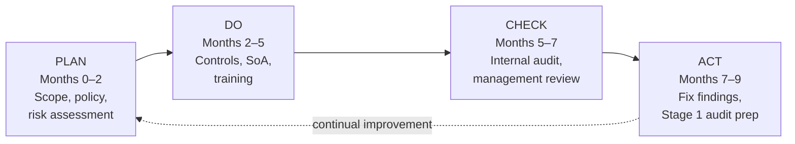

# NovaCare Health Services: ISO/IEC 27001:2022 ISMS Readiness Assessment

A gap analysis and certification roadmap for a growing healthcare provider with no formal information security management system (ISMS). I defined the ISMS scope, assessed current practice against ISO/IEC 27001:2022, recommended prioritised Annex A controls, and set out a 9-month plan to reach Stage 1 audit readiness using the Plan-Do-Check-Act (PDCA) model.

> **Context:** Capstone project for the 10Alytics GRC programme (cohort C26-06), completed August 2026 in the role of Junior GRC Consultant. NovaCare is a fictional organisation provided as a case study.

---

## At a glance

| | |
|---|---|
| **Framework** | ISO/IEC 27001:2022 (Clauses 4–10, Annex A) |
| **Sector** | Healthcare (3 outpatient clinics) |
| **Role** | Junior GRC Consultant |
| **Deliverables** | ISMS scope statement, gap analysis, Annex A recommendations, PDCA roadmap |
| **Key result** | 7 gaps identified (4 High, 3 Medium); 9-month route to Stage 1 audit readiness |

## Contents

- [The scenario](#the-scenario)
- [My approach](#my-approach)
- [ISMS scope](#isms-scope)
- [Key findings](#key-findings)
- [Recommendations](#recommendations)
- [Roadmap to certification](#roadmap-to-certification)
- [Skills demonstrated](#skills-demonstrated)
- [Files in this repository](#files-in-this-repository)

---

## The scenario

NovaCare Health Services runs three outpatient clinics and handles patient records, appointment scheduling, payroll, supplier information and financial transactions across a mix of cloud and on-premises systems. As the organisation grew, management decided to formalise information security and pursue ISO/IEC 27001 certification.

A review of existing documentation and stakeholder interviews (IT, clinical and administrative staff) showed security was being managed informally:

> *"We don't have a formal risk register; decisions on security are made case by case."*

There was no ISMS scope, no approved policy suite, no risk register and no Statement of Applicability. Controls varied between clinics, suppliers were not vetted for security, and staff received no regular awareness training.

## My approach

1. **Define the scope:** set clear boundaries for the ISMS (locations, people, departments, information assets and systems).
2. **Review current practice:** used documentation and stakeholder interviews to understand how security was actually being managed.
3. **Gap analysis:** compared current practice against ISO/IEC 27001:2022 Clauses 4–10 and the 93 Annex A controls.
4. **Prioritise:** ranked each gap by the risk it posed to NovaCare's core assets:
   - **Patient records:** confidentiality and regulatory risk
   - **Financial and payroll data:** integrity and fraud risk
   - **Clinic operations:** availability risk
5. **Plan:** turned the recommendations into a time-bound PDCA roadmap.

## ISMS scope

The ISMS covers all people, processes and technology involved in creating, processing, storing and transmitting NovaCare's sensitive information across all three clinics.

| Area | In scope |
|---|---|
| **Locations** | All three outpatient clinics |
| **People** | Employees, contractors and third-party suppliers who access NovaCare information |
| **Departments** | IT, Clinical, Administration |
| **Information assets** | Patient information, payroll, supplier information, financial transaction records |
| **Systems** | Appointment scheduling, cloud platforms, on-premises systems |
| **Governance activities** | Policy management, risk assessment, incident management, supplier due diligence |

**Exclusions:** none at this stage.

## Key findings

| # | Gap | ISO 27001 ref. | Category | Priority |
|---|---|---|---|---|
| G1 | No defined ISMS scope | Clause 4.3 | Organisational | 🔴 High |
| G2 | Policies incomplete, outdated or not approved by management | Clause 5.2 / A.5.1 | Organisational | 🔴 High |
| G3 | No asset inventory; patient, payroll and supplier data not classified | A.5.9 | Organisational | 🔴 High |
| G4 | No formal risk assessment or risk register | Clause 6.1.2 | Organisational | 🔴 High |
| G5 | No Statement of Applicability | Clause 6.1.3 | Organisational | 🟠 Medium |
| G6 | No regular security awareness training | A.6.3 | People | 🟠 Medium |
| G7 | Suppliers not security-vetted before onboarding | A.5.19 / A.5.20 | Organisational | 🟠 Medium |

The full table, with recommended controls, is in [`data/gap-analysis.csv`](data/gap-analysis.csv).

**Main insight:** almost every gap is in the *Organisational* category. NovaCare's problem is not a lack of technical capability; it is missing governance foundations (scope, policy, asset inventory and a risk register). Every later control decision depends on these, so they need to come before any major spend on technical controls.

## Recommendations

**High priority**
- **A.5.1 Policies for information security:** draft a top-level information security policy, get management approval and communicate it to staff. Subordinate policies (access control, acceptable use, data classification) follow from it.
- **A.5.9 Inventory of information assets:** build an asset register across all three clinics, with a named owner for each asset.
- **A.5.12 Classification of information:** classify those assets (for example, patient records as highly confidential) so controls are proportionate.
- **Risk methodology and register (Clause 6.1.2):** replace case-by-case decisions with a documented, repeatable risk assessment.

**Medium priority**
- **A.6.3 Awareness, education and training:** a recurring programme for clinical, IT and admin staff covering data handling, phishing and incident reporting.
- **A.5.19 / A.5.20 Supplier relationships:** a supplier security due-diligence checklist and standard security clauses in contracts, applied before onboarding.
- **Statement of Applicability (Clause 6.1.3):** once the risk assessment is done, document the applicability (or justified exclusion) of all 93 Annex A controls and keep it up to date.

## Roadmap to certification

| Stage | Actions | Timeline |
|---|---|---|
| **Plan** | Define scope and context; approve policy; complete gap analysis and risk assessment; build asset inventory and risk register | 0–2 months |
| **Do** | Implement High-priority Annex A controls; document the SoA; roll out supplier checks and awareness training | 2–5 months |
| **Check** | Internal audit against Clauses 4–10 and the SoA; test control effectiveness; management review | 5–7 months |
| **Act** | Fix nonconformities; update policies and controls; prepare for the external Stage 1 audit | 7–9 months |

## Skills demonstrated

- **ISO/IEC 27001:2022:** ISMS scoping, Clauses 4–10, Annex A control selection, Statement of Applicability
- **Gap analysis:** assessing current practice against a standard and prioritising by risk
- **Risk-based thinking:** linking each gap to the confidentiality, integrity and availability of specific assets
- **Stakeholder engagement:** gathering evidence through interviews across IT, clinical and admin teams
- **Roadmap planning:** turning findings into a sequenced, time-bound PDCA programme
- **Clear reporting:** writing for management, not just technical readers

## Files in this repository

| File | What it is |
|---|---|
| [`docs/NovaCare-ISO27001-Capstone-Report.pdf`](docs/NovaCare-ISO27001-Capstone-Report.pdf) | Full capstone report as submitted |
| [`data/gap-analysis.csv`](data/gap-analysis.csv) | Gap analysis table with recommended controls |
| [`data/pdca-roadmap.csv`](data/pdca-roadmap.csv) | PDCA improvement plan and timeline |

---

← [Back to portfolio](../../README.md)
