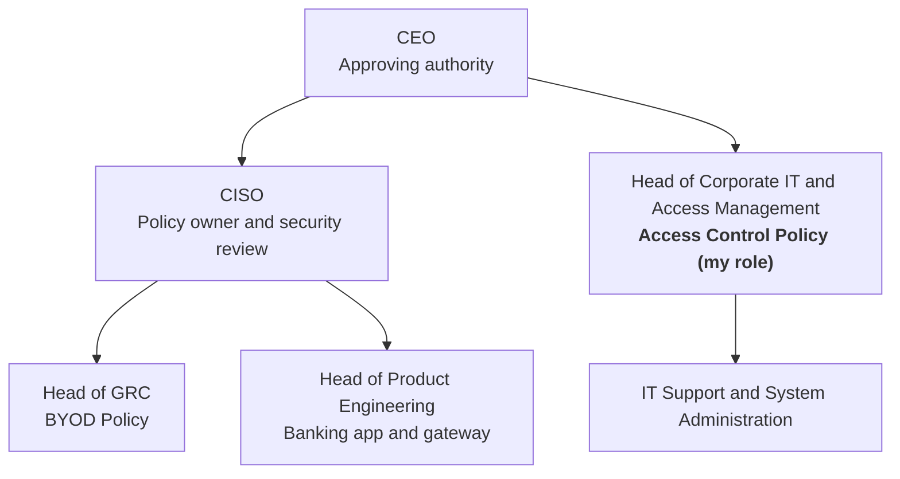

# NovaPay: ISO/IEC 27001 Internal Audit and Policy Framework

Building auditable security policies for a regulated FinTech, then testing them the way an internal auditor would. Our team wrote two ISO/IEC 27001:2022-aligned policies (Access Control and BYOD), reviewed them for gaps, and produced an audit checklist that names the evidence needed to show each policy is being followed.

> **Context:** Group project for the 10Alytics GRC programme (cohort C26-06), September 2026. Four team members each took a role in a simulated organisation. **My role: Head of Corporate IT and Access Management. I wrote the Access Control Policy.** NovaPay is a fictional organisation provided as a case study.

---

## At a glance

| | |
|---|---|
| **Framework** | ISO/IEC 27001:2022 (Annex A) |
| **Sector** | FinTech: payment gateway and mobile banking app |
| **My role** | Head of Corporate IT and Access Management (author, Access Control Policy) |
| **Team deliverables** | 2 policies, 3 policy gaps with fixes, 5-question audit checklist |
| **My deliverable** | [Access Control Policy](policies/access-control-policy.md) (15 sections, full document control) |

## Contents

- [The scenario](#the-scenario)
- [Governance structure](#governance-structure)
- [The Access Control Policy (my work)](#the-access-control-policy-my-work)
- [Policy review: gaps found](#policy-review-gaps-found)
- [Internal audit checklist](#internal-audit-checklist)
- [Skills demonstrated](#skills-demonstrated)
- [Files in this folder](#files-in-this-folder)

---

## The scenario

NovaPay is a regulated FinTech with 240 staff across two offices. It runs a payment gateway and a customer-facing banking app, hosts customer data in Microsoft Azure, relies on third-party integrations, and has remote and hybrid staff using their own devices.

It was preparing for ISO 27001 certification but had:
- no complete information security policy framework
- inconsistent security practice between teams
- policies and procedures that were not clearly documented
- little evidence that security requirements were actually being followed

The brief: develop two policies, review them for gaps, and write audit questions to check compliance.

## Governance structure

We designed a simple structure so every policy has a clear owner, author and approver.

## The Access Control Policy (my work)

📄 **[Read the full policy](policies/access-control-policy.md)**

The policy covers the full access lifecycle (request, approval, authentication, review and removal) for the banking app, payment gateway, Azure services and admin accounts.

**Key requirements**
- **Least privilege and need to know:** users get only the access their role needs.
- **Segregation of duties:** for example, the person who approves a payment should not also execute it.
- **Three-step approval:** manager requests, system owner approves, Corporate IT grants.
- **One user, one ID:** no shared accounts or passwords.
- **MFA** for Azure, remote access, payment systems and all privileged accounts.
- **Access reviews:** every 6 months for standard users; every 90 days for privileged and third-party access.
- **Privileged accounts:** separate admin accounts, a maintained register, logged and monitored use, time-limited temporary access.
- **Leavers and movers:** access updated or removed and the action recorded.

**How the policy maps to ISO/IEC 27001:2022 Annex A**

| Policy section | Annex A control |
|---|---|
| Access control principles, role-based access | A.5.15 Access control |
| Segregation of duties | A.5.3 Segregation of duties |
| Unique identifiers | A.5.16 Identity management |
| Authentication, password rules | A.5.17 Authentication information; A.8.5 Secure authentication |
| Requests, reviews, leavers | A.5.18 Access rights |
| Privileged and administrator accounts | A.8.2 Privileged access rights |
| Confidentiality agreements | A.6.6 Confidentiality or non-disclosure agreements |
| Leavers and role changes | A.6.5 Responsibilities after termination or change of employment |

## Policy review: gaps found

Reviewing our own drafts with an auditor's eye exposed three weaknesses: requirements that were stated but could not be checked or evidenced.

| Policy | Gap | Improvement | Annex A |
|---|---|---|---|
| BYOD | Device requirements listed, but no check before a device connects | Corporate IT approves each device before access (for example, via MDM) | A.8.1 |
| BYOD | No list of approved personal devices | Register of device, user, approval date and access status | A.5.9 |
| Access Control | Leavers' access removed "promptly", but no deadline or record | Immediate notification; access revoked within 24 hours; completion recorded | A.5.18 |

**Lesson:** a policy is only auditable if it says *when*, *who* and *what record proves it*. "Promptly" can't be tested; "within 24 hours, logged in the access ticket" can.

## Internal audit checklist

Each question is paired with the evidence an auditor would ask for, so findings rest on records rather than interviews alone.

| # | Policy | Audit question | Evidence to request |
|---|---|---|---|
| 1 | BYOD | Do personal devices meet the screen-lock, patching and encryption requirements? | Security settings or compliance records for a sample of devices |
| 2 | BYOD | Were lost or stolen devices reported within one hour? | Incident reports with reporting times and actions taken |
| 3 | Access Control | Did the system owner approve access before Corporate IT granted it? | Access requests, approvals and account records |
| 4 | Access Control | Were access reviews completed at the required intervals? | Dated reviews and records of changes made |
| 5 | Access Control | Was access changed or removed when people changed roles or left? | Manager notifications, access tickets and account logs |

## Skills demonstrated

- **Policy writing:** a complete, approvable policy with document control, review cycle and exceptions process
- **Identity and access management:** least privilege, segregation of duties, MFA, privileged access and joiner-mover-leaver processes
- **ISO/IEC 27001:2022:** mapping policy requirements to Annex A controls
- **Internal audit:** designing audit questions and identifying the evidence needed to test them
- **Critical review:** spotting requirements that are vague or can't be tested
- **Teamwork:** working within a defined role in a four-person team

## Files in this folder

| File | What it is |
|---|---|
| [`policies/access-control-policy.md`](policies/access-control-policy.md) | The Access Control Policy I wrote |
| [`data/policy-gaps.csv`](data/policy-gaps.csv) | Policy gaps and improvements (team output) |
| [`data/audit-checklist.csv`](data/audit-checklist.csv) | Internal audit questions and evidence (team output) |

---

← [Back to portfolio](../../README.md)
