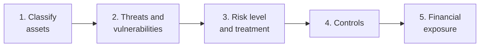

# NovaPay: Enterprise Risk Assessment for a Regulated FinTech

A board-ready risk assessment of three connected risks at a payment service provider: weak admin access to the customer database, an unprotected mobile login, and an unassessed payment vendor. I classified the assets, identified threats and vulnerabilities, chose treatments against the company's risk appetite, recommended controls, and put a number on the financial exposure using SLE, ARO and ALE.

> **Context:** Individual case study for the 10Alytics GRC programme (cohort C26-06), 2026, in the role of Junior Risk Analyst on NovaPay's Risk Committee. NovaPay is a fictional organisation provided as a case study.

---

## At a glance

| | |
|---|---|
| **Discipline** | Enterprise Risk Management (ERM) |
| **Sector** | FinTech: licensed payment service provider |
| **Role** | Junior Risk Analyst, Risk Committee |
| **Risks assessed** | 3 (customer database, mobile app login, payment vendor) |
| **Key result** | All 3 rated **High** and **Mitigate**; 6 controls recommended; database breach exposure **₦15m per year (ALE)** |

## Contents

- [The scenario](#the-scenario)
- [My approach](#my-approach)
- [1. Asset classification](#1-asset-classification)
- [2. Threats and vulnerabilities](#2-threats-and-vulnerabilities)
- [3. Risk treatment](#3-risk-treatment)
- [4. Recommended controls](#4-recommended-controls)
- [5. Financial exposure](#5-financial-exposure-sle-aro-ale)
- [Skills demonstrated](#skills-demonstrated)

---

## The scenario

NovaPay is a FinTech licensed as a payment service provider, with 120 staff, over 500,000 customer wallets and more than 8,000 small-business merchants.

The Head of Compliance escalated three issues to the Risk Committee ahead of a board meeting:

> *Rising complaints about unauthorised transfers, unusual admin traffic on the Payment Gateway, and a formal incident notice from PaySecure Ltd, our payment vendor.*

**Risk appetite:** NovaPay has almost no tolerance for risks that threaten customer funds, customer data or its licence to operate. **Only Low risks may be accepted without treatment.**

## My approach



Every recommendation is written in plain language for a board audience, as the brief asked.

## 1. Asset classification

Classification decides how strongly each asset must be protected (Public → Internal → Confidential → Restricted).

| Asset | Owner | Classification | Why |
|---|---|---|---|
| Customer database | Head of IT | 🔴 **Restricted** | Highly sensitive personal, financial and transaction data. Disclosure could cause fraud, regulatory penalties and reputational damage. |
| Mobile app login | Head of Product | 🔴 **Restricted** | Gateway to customer wallets and transactions. Compromise leads straight to account takeover and unauthorised transfers. |
| PaySecure Ltd (vendor) | Head of Compliance | 🟠 **Confidential** | Vendor assessments, contracts, access details and data-sharing arrangements are sensitive business information. |

## 2. Threats and vulnerabilities

*Threat: what could go wrong. Vulnerability: the weakness that makes it possible.*

| Asset | Threat | Vulnerability |
|---|---|---|
| Customer database | Unauthorised admin access and data theft | No MFA, shared admin passwords, no alerts on unusual access |
| Mobile app login | Account takeover, credential stuffing, unauthorised transfers | No customer MFA, no login rate limiting, weak monitoring |
| PaySecure Ltd | Third-party data breach, unauthorised disclosure | No vendor security assessment; data-sharing boundaries undocumented |

## 3. Risk treatment

| Risk | Level | Treatment | Rationale |
|---|---|---|---|
| Customer database | 🔴 High | **Mitigate** | Strong access controls reduce the likelihood of unauthorised access |
| Mobile app login | 🔴 High | **Mitigate** | Authentication and monitoring controls reduce account-takeover risk |
| PaySecure Ltd | 🔴 High | **Mitigate** | Vendor assessment, contract security clauses and ongoing monitoring reduce third-party risk |

**Why not accept, avoid or transfer?** All three risks are High, and NovaPay's appetite only allows Low risks to be accepted. Avoiding them isn't realistic, because the database, app and payment vendor *are* the business. Insurance could transfer some financial loss, but it wouldn't protect customers or the licence. That leaves mitigation as the only option that fits the appetite.

## 4. Recommended controls

| Risk | Control 1 | Control 2 | ISO/IEC 27001:2022 reference |
|---|---|---|---|
| Customer database | Enforce MFA on admin accounts; end password sharing | Log database access; alert on unusual admin activity | A.8.2, A.8.5, A.5.17, A.8.15, A.8.16 |
| Mobile app login | Introduce customer MFA | Rate limiting, temporary lockouts, suspicious-transaction monitoring | A.8.5, A.8.16 |
| PaySecure Ltd | Vendor security assessment plus scheduled vendor-risk reviews | Secure data-sharing arrangements limited to authorised parties | A.5.19, A.5.20, A.5.22, A.5.14 |

The full register is in [`data/risk-register.csv`](data/risk-register.csv).

## 5. Financial exposure (SLE, ARO, ALE)

Putting a number on the database risk turns "this is serious" into a figure the board can weigh against the cost of controls.

| Input | Value |
|---|---|
| Asset value (AV) | ₦50,000,000 |
| Exposure factor (EF) | 60% |
| Annualised rate of occurrence (ARO) | 0.5 (once every 2 years) |

```
SLE = AV × EF   = ₦50,000,000 × 0.60 = ₦30,000,000   (cost of one breach)
ALE = SLE × ARO = ₦30,000,000 × 0.5  = ₦15,000,000   (expected loss per year)
```

**What this means for the board:** a database breach is expected to cost NovaPay about **₦15 million a year** on average. Any combination of controls that costs less than this each year, and meaningfully cuts the likelihood, is financially justified before even counting regulatory and reputational damage.

## Skills demonstrated

- **Risk assessment:** asset identification, data classification, threat and vulnerability analysis
- **Risk treatment:** choosing avoid / mitigate / transfer / accept against a stated risk appetite
- **Quantitative risk analysis:** SLE, ARO and ALE, turned into a cost-benefit argument
- **Control selection:** practical controls mapped to ISO/IEC 27001:2022 Annex A
- **Identity and access security:** MFA, privileged access, credential stuffing defences, monitoring
- **Third-party risk:** vendor assessment and data-sharing controls
- **Board communication:** turning technical findings into plain-language decisions

## Files in this folder

| File | What it is |
|---|---|
| [`data/risk-register.csv`](data/risk-register.csv) | Full risk register: classification, threats, vulnerabilities, treatment and controls |

---

← [Back to portfolio](../../README.md)
