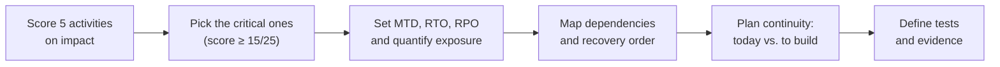

# Meridian Pay: Business Impact Analysis and Business Continuity Plan

After a phishing attack disrupted a payments company with no continuity plan, I worked out which services it could least afford to lose, how long each could be down, and how to keep them running. My Business Impact Analysis set recovery targets for payments, fraud monitoring and bank settlement; my Business Continuity Plan turned those targets into triggers, workarounds and tests.

> **Context:** Group project for the 10Alytics GRC programme (cohort C26-06), October 2026. A five-person GRC advisory team produced an integrated incident response, continuity and privacy report. **My deliverables: the Business Impact Analysis (Section 6) and Business Continuity Plan (Section 7).** Teammates wrote the incident response plan, playbooks, crisis communications and DPIA. Meridian Pay is a fictional organisation provided as a case study.

---

## At a glance

| | |
|---|---|
| **Discipline** | Business continuity and operational resilience |
| **Standards referenced** | ISO 22301 (business continuity), ISO/IEC 27001 |
| **Sector** | Regulated digital payments: 600,000 customers, 9,000 merchants, ~150,000 transactions a day |
| **My role** | Author, Business Impact Analysis and Business Continuity Plan |
| **Key result** | 5 activities scored and given recovery targets; 3 critical activities analysed in depth; continuity plans that separate "ready today" from "still to build"; a 5-part testing programme |

## Read my work

| Document | What it covers |
|---|---|
| 📄 **[Business Impact Analysis](docs/business-impact-analysis.md)** | Activity scoring, MTD/RTO/RPO, the settlement clock-time rule, revenue at risk, dependencies, recovery sequence |
| 📄 **[Business Continuity Plan](docs/business-continuity-plan.md)** | Activation triggers, step-by-step response, continuity arrangements per service, suppliers, testing schedule |

---

## The scenario

Meridian Pay processes about **₦2.5 billion a day** (about ₦18 million in revenue) on a 24/7 cloud platform and must settle with three partner banks by a **fixed 10:00 cut-off**. Its four-person security team only works business hours.

A customer support employee clicked a phishing link, which was followed by suspicious account activity, possible access to customer data and payment disruption. Meridian Pay had **no incident response, business continuity or disaster recovery plan.**

## My approach

## Key findings

**1. Three activities are critical.** Each was scored on five impact criteria:

| Activity | Score /25 | Full BIA? |
|---|---|---|
| Payment processing | **23** | ✅ |
| Fraud monitoring | **22** | ✅ |
| Settlement (10:00 cut-off) | **17** | ✅ |
| Onboarding and KYC | 12 | Covered by the team's DPIA |
| Customer support | 11 | Covered by incident response |

**2. All five activities get recovery targets; the three critical ones have the tightest.**

| Activity | Max tolerable downtime | Recovery time target | Data loss tolerance |
|---|---|---|---|
| Payment processing | 4 hours | 1 hour | 0 minutes |
| Fraud monitoring | **10 minutes** | **5 minutes** | 0 (alerts and evidence) |
| Settlement | Set by the clock (see below) | Set by the clock | 0 minutes |
| Onboarding and KYC | 24 hours | 8 hours | 4 hours |
| Customer support | 8 hours | 2 hours | 1 hour |

**3. Settlement is a clock problem, not a duration problem.** With a 10:00 cut-off and a 30-minute settlement run, systems must be usable by 09:00 (target) and no later than 09:30. An outage at 09:30 *cannot* be fixed technically in time, even with a 5-minute failover. The only options are contingency routes and early warning to the banks. *Technical restoration is not the same as business recovery.*

**4. Every hour of payment downtime puts about ₦104 million of transactions and ₦750,000 of revenue at risk.** At 4 hours, one-sixth of daily revenue is exposed, which is the basis for the 4-hour maximum. Full table: [`data/revenue-at-risk.csv`](data/revenue-at-risk.csv).

**5. Fraud monitoring must come back first.** It has the shortest tolerance (10 minutes), so it is restored *before* payments fully reopen. If it can't be restored in time, payments run in a restricted "degraded mode" (lower limits, held high-risk transactions, step-up checks) rather than unprotected.

**6. Recovery targets depend on things that don't exist yet.** Failover, alternative settlement channels and 24/7 monitoring are all unconfirmed. So for every service, the BCP shows the **workaround available today** separately from the **capability still to be built and tested.** Nothing is treated as ready until it has been evidenced.

## Top recommendations

1. Treat **24/7 monitoring and on-call cover as a precondition**, not a later improvement.
2. **Agree alternative settlement routes** with all three partner banks.
3. **Commission a Disaster Recovery Plan**; the BCP's technical recovery depends on one.
4. **Test, then approve**: failover against the 1-hour target, settlement drills including a late-morning scenario, and quarterly out-of-hours alert tests.

## Relevance to UK roles

The same thinking sits behind the UK's **FCA and PRA operational resilience rules** (FCA PS21/3), which require payments and financial firms to identify important business services, set *impact tolerances* (the maximum tolerable disruption), map dependencies and test against severe but plausible scenarios. This BIA follows that pattern: critical services, maximum tolerable downtime, dependency mapping and scenario-based testing.

## Skills demonstrated

- **Business impact analysis:** impact scoring, MTD, RTO and RPO, dependency mapping, recovery sequencing
- **Business continuity planning:** activation triggers, degraded-mode operations, supplier and people continuity
- **Quantitative analysis:** revenue-at-risk modelling with peak-hour sensitivity
- **Operational resilience thinking:** clock-time deadlines, "today vs. to build" capability gaps, test-before-approve
- **Testing design:** exercise programme with frequencies and evidence requirements
- **Honest reporting:** stating assumptions and limits clearly rather than overstating readiness
- **Teamwork:** aligning my sections with a teammate's incident response plan, severity scale and roles

## Files in this folder

| File | What it is |
|---|---|
| [`docs/business-impact-analysis.md`](docs/business-impact-analysis.md) | My full Business Impact Analysis |
| [`docs/business-continuity-plan.md`](docs/business-continuity-plan.md) | My full Business Continuity Plan |
| [`data/activity-prioritisation.csv`](data/activity-prioritisation.csv) | Impact scoring of the five core activities |
| [`data/recovery-objectives.csv`](data/recovery-objectives.csv) | MTD, RTO and RPO for each critical activity |
| [`data/revenue-at-risk.csv`](data/revenue-at-risk.csv) | Payment-processing exposure by outage length |

---

← [Back to portfolio](../../README.md)
