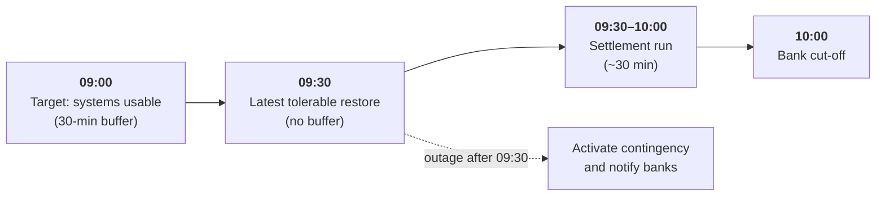
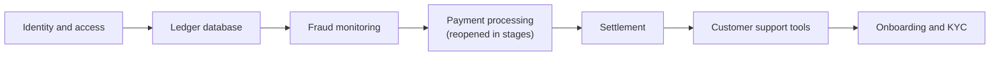

# Meridian Pay: Business Impact Analysis

> Written by Jemimah Jacobs as Section 6 of the Meridian Pay [incident response, continuity and privacy group report](../README.md). Meridian Pay is a fictional organisation.

**Key message:** payments, fraud monitoring and settlement are the activities Meridian Pay cannot afford to lose. All five core activities have recovery targets; these three have the tightest.

| | |
|---|---|
| **Status** | Proposed. Subject to management approval, technical feasibility assessment and recovery testing. |
| **Method** | Impact-based scoring of five core activities, then financial, operational, reputational and regulatory impact over time. Informed by ISO 22301 and ISO/IEC 27001. |

---

## 1. Selecting the critical activities

Each of Meridian Pay's five core activities was scored 1–5 (5 is worst) against five criteria. For workaround difficulty, 5 means no viable manual workaround. **Rule: a total of 15 or more receives a full BIA.**

| Activity | Financial exposure | Time sensitivity | Customer / regulatory impact | Dependency | Workaround difficulty | **Total /25** |
|---|---|---|---|---|---|---|
| Payment processing | 5 | 4 | 5 | 5 | 4 | **23** |
| Fraud monitoring | 4 | 5 | 5 | 4 | 4 | **22** |
| Settlement (10:00 cut-off) | 3 | 5 | 4 | 2 | 3 | **17** |
| Customer onboarding and KYC | 2 | 2 | 4 | 2 | 2 | 12 |
| Customer support | 2 | 3 | 3 | 1 | 2 | 11 |

Onboarding and KYC scores low on time-criticality but holds the most sensitive data, so it is covered by the team's Data Protection Impact Assessment instead. Customer support is covered by the incident response arrangements and the BCP's supporting-services notes. Scores should be validated with Meridian Pay's business owners.

## 2. Recovery requirements

| Critical activity | MTD | RTO | RPO | Basis |
|---|---|---|---|---|
| Payment processing | 4 hours | 1 hour | 0 minutes | 24/7 platform; about ₦104 million transaction value per hour |
| Fraud monitoring | 10 minutes | 5 minutes | 0 for alerts and evidence; 24 hours for rule configuration | Continuous exposure; security team works business hours only |
| Settlement with partner banks | 90 minutes\* | 60 minutes\* | 0 minutes | Fixed 10:00 cut-off; see the clock-time rule below |
| Customer onboarding and KYC | 24 hours | 8 hours | 4 hours | About 800 applications a day; delay is reversible and applicants can be queued, but KYC obligations and new-customer revenue are affected beyond one business day |
| Customer support | 8 hours | 2 hours | 1 hour | 40 agents; alternate channels (email, telephone, web chat) can run within 2 hours; longer outages drive complaints and regulatory enquiries during an incident |

**MTD** (maximum tolerable downtime) is the longest disruption tolerable. **RTO** (recovery time objective) is the target time to restore. **RPO** (recovery point objective) is the acceptable data loss.

\*Settlement figures apply to an illustrative disruption starting at 08:00. All targets are proposed requirements, not demonstrated capability. A zero-minute RPO means preventing permanent loss of confirmed records; it usually implies synchronous replication, which must be costed.

## 3. Settlement: the clock-time rule

Because the cut-off is fixed, **settlement recovery is set by the clock, not by a duration.** Assuming settlement needs about 30 minutes once systems are usable (to be validated with settlement operations):

- **Target:** settlement systems and records usable by **09:00** each day, leaving a 30-minute buffer.
- **Latest tolerable:** **09:30**, with no buffer. For any disruption starting before 09:30, restoration is required by then.
- **After 09:30:** technical restoration alone cannot complete that day's settlement. Activate the contingency channel immediately and notify the partner banks.
- **Illustration:** an 08:00 disruption gives a 60-minute RTO (usable by 09:00) and a 90-minute MTD (usable by 09:30), as in the table above.

**Example:** with an outage at 09:30, even a five-minute backup activation leaves about 25 minutes, so a 30-minute settlement run finishes at around 10:05 and misses the cut-off. *Technical restoration is not the same as business recovery.*

## 4. Financial exposure: payment processing

Assuming even distribution over 24 hours, using ₦2.5 billion daily transaction value and ₦18 million daily revenue:

| Disruption | Transaction value affected | Revenue at risk | Provisional rating |
|---|---|---|---|
| 15 minutes | ₦26.04 million | ₦187,500 | 🟢 Low |
| 1 hour | ₦104.17 million | ₦750,000 | 🟡 Moderate |
| 2 hours | ₦208.33 million | ₦1.5 million | 🟠 High |
| 3 hours | ₦312.5 million | ₦2.25 million | 🟠 High |
| 4 hours | ₦416.67 million | ₦3 million | 🔴 Critical |

- **These are exposure estimates, not confirmed losses.** Some transactions will complete after restoration.
- **Peak-hour sensitivity:** daytime volumes are likely above average. At 1.5× or 2× the average, one hour of disruption affects about ₦156 million or ₦208 million of transaction value.
- **Revenue understates the real exposure.** Customer compensation, partner and merchant penalties, regulatory consequences and customer churn are not counted.
- **Basis for the 4-hour MTD:** at four hours, about one-sixth of daily revenue is at risk. This is a provisional threshold for management to confirm against approved financial tolerances, merchant agreements and regulator expectations.

## 5. Impact by activity

| Activity | Operational | Reputational | Regulatory and compliance |
|---|---|---|---|
| Payment processing | Failed transactions, backlog, pressure on support | Lower customer confidence, merchant complaints | Scrutiny of operational resilience and transaction integrity |
| Settlement | Missed cut-off, delayed merchant payments, reconciliation backlog | Partner bank and merchant confidence | Settlement obligations, record accuracy |
| Fraud monitoring | Undetected suspicious activity, delayed investigations | Trust as a payment provider | Security and fraud-prevention duties, incident reporting |
| Onboarding and KYC | Application backlog, delayed account opening | Lost new customers, poor first impression | KYC obligations, record accuracy |
| Customer support | Unanswered enquiries, complaint backlog | Customer frustration during an incident | Complaint-handling expectations, data-request deadlines under data protection law |

## 6. Dependencies and recovery sequence

| Activity | Key dependencies | If a dependency fails |
|---|---|---|
| Payment processing | Cloud infrastructure, payment applications, transaction databases, network, payment integrations, technical staff | Transaction failures, delays, revenue exposure |
| Settlement | Settlement applications, accurate transaction records, secure bank connectivity, settlement staff, partner banks | Missed deadlines, delayed merchant payments |
| Fraud monitoring | Detection systems, transaction data feeds, rules, alerting, security personnel | Late detection, higher fraud exposure |
| Onboarding and KYC | Verification vendor, KYC system, document storage, compliance staff | Backlog, manual review load, missed regulatory checks |
| Customer support | Support console, telephony, customer database, agents | Enquiries unanswered, fraud reports missed |

**Shared dependencies** (a single failure can hit several activities at once): cloud hosting, identity and access, network connectivity, the transaction ledger, and the people who run all five.

**Recovery sequence after a major disruption:**

Fraud monitoring returns **before** payments reopen fully because its tolerance (10 minutes) is the shortest.

## 7. Findings and recommendations

| Finding | Recommendation | Priority |
|---|---|---|
| Recovery arrangements have not been demonstrated through testing | Document and test recovery procedures against approved objectives | 🔴 Critical |
| Payment processing depends on continuous technology availability | Resilient infrastructure, transaction protection, tested failover | 🔴 Critical |
| Settlement has a fixed 10:00 cut-off | Clock-time rule; approved alternative settlement arrangements with each bank | 🔴 Critical |
| Fraud monitoring interruption exposes customers; no confirmed after-hours cover | Automated failover, continuous alerting, predefined transaction restrictions, out-of-hours responder | 🔴 Critical |
| Critical activities share systems and suppliers | Validate dependencies; assess third-party continuity | 🟠 High |
| Targets lack formal business approval | Management approval and accountable business owners | 🟠 High |

## 8. Assumptions and limitations

- Volumes and revenue are assumed evenly distributed; actual exposure varies with peaks.
- Settlement needs about 30 minutes after systems are usable (to be validated).
- The availability of automated fraud controls, independent transaction limits and overnight monitoring has not been confirmed.
- Partner bank, cloud provider and other supplier recovery capabilities and contract terms have not been assessed.
- The proposed MTD, RTO and RPO values need management approval, technical validation and testing.

---

Next: [Business Continuity Plan →](business-continuity-plan.md) · [Back to case study](../README.md)
