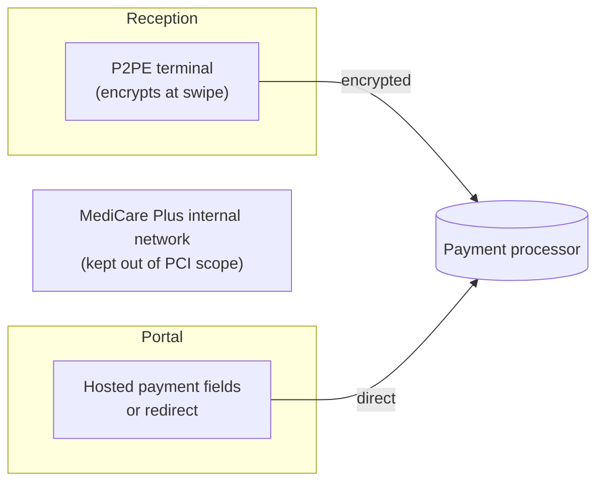

# MediCare Plus: PCI DSS and HIPAA Compliance Assessment

Two incidents at a private hospital, assessed against two very different regulatory frameworks. For card payments, I identified the applicable PCI DSS v4.0.1 requirements and showed how to shrink the compliance scope with point-to-point encryption and tokenisation. For staff snooping in patient records, I confirmed the data was protected health information (PHI) and set out a four-step plan to restrict access using HIPAA's administrative and technical safeguards.

> **Context:** Individual assessment for the 10Alytics GRC programme (cohort C26-06), submitted August 2026. MediCare Plus is a fictional organisation provided as a case study.

---

## At a glance

| | |
|---|---|
| **Frameworks** | PCI DSS v4.0.1 · HIPAA Privacy and Security Rules |
| **Sector** | Healthcare: in-person and online card payments, electronic health records |
| **Role** | Compliance analyst (individual assessment) |
| **Key result** | 10 PCI DSS requirements mapped to the hospital's payment setup; scope-reduction strategy; 4-step HIPAA access remediation plan |

## Contents

- [Incident 1: card payments (PCI DSS)](#incident-1-card-payments-pci-dss)
- [Incident 2: patient records (HIPAA)](#incident-2-patient-records-hipaa)
- [Relevance to UK roles](#relevance-to-uk-roles)
- [Skills demonstrated](#skills-demonstrated)
- [Files in this folder](#files-in-this-folder)

---

## Incident 1: card payments (PCI DSS)

**The situation:** MediCare Plus takes card payments at reception and through an online patient portal, and passes card data to a third-party payment processor.

### Which requirements apply?

| Req. | Objective | How it applies to MediCare Plus |
|---|---|---|
| **1** | Network security controls | Segment the payment environment from clinical networks, IT and public Wi-Fi |
| **2** | Secure configurations | Change default passwords on POS terminals; harden before use |
| **3** | Protect stored data | Don't keep card data at all if possible; if any is stored, make the card number unreadable; **never** store the CVV after authorisation |
| **4** | Protect data in transit | Strong cryptography across open networks |
| **5** | Protect against malware | Cover reception systems and the online payment channel |
| **6** | Secure systems and software | Defend the portal against SQL injection, XSS and similar; patch promptly |
| **7** | Restrict access | Billing and reception only, not clinical or IT staff in general |
| **8** | Identify and authenticate | Unique logins and MFA for terminals and the portal admin panel |
| **9** | Restrict physical access | Secure terminals, receipts showing card numbers and physical media |
| **12** | Policy and programmes | Security policy, third-party assessment, incident response plan, staff training |

Full mapping: [`data/pci-dss-requirements.csv`](data/pci-dss-requirements.csv)

### How should MediCare Plus protect cardholder data?

The cheapest card data to protect is card data you never touch. My recommendations focus on **shrinking the scope** first:

1. **Reduce scope with P2PE and tokenisation:** a PCI-validated point-to-point encryption terminal encrypts card data at the moment of payment and sends it straight to the processor, keeping the hospital's network out of scope. On the portal, hosted payment fields or a redirect mean card data never touches MediCare Plus's servers.
2. **Never store the security code:** the CVV must never be kept after authorisation. Other card data (card number, name, expiry) may only be stored if properly protected under Requirement 3.
3. **Segment the payment network:** VLANs and firewalls isolate the cardholder data environment so medical devices and admin systems can't reach payment channels.
4. **Manage vendors:** verify an annual Attestation of Compliance (AoC) from every payment gateway and cloud provider that touches card data.

---

## Incident 2: patient records (HIPAA)

**The situation:** staff were viewing patient medical records they had no need to see.

### Is this PHI?

**Yes.** Under the HIPAA Privacy Rule, PHI is individually identifiable health information created, received, stored or transmitted by a covered entity. The records combine **health data** (diagnoses, prescriptions, treatment notes) with **identifiers** (names, medical record numbers, addresses, dates of birth). Any unauthorised internal viewing is an improper exposure of PHI.

### Which safeguards apply?

| Safeguard category | Standards | How it applies |
|---|---|---|
| **Administrative** | Workforce security and information access management; minimum necessary standard | Access limited to what each role requires, with sanctions for staff who don't comply |
| **Technical** | Access control; audit controls | The EHR must restrict user privileges and record who accessed which records, and when |

### Action plan: restricting access

| # | Action | Type | What it involves |
|---|---|---|---|
| 1 | **Role-based access control** | Technical + administrative | Permissions follow the job: billing sees billing fields only; clinicians see only patients in their care unit |
| 2 | **Enforce minimum necessary** | Administrative | Elevated access needs manager approval and a stated reason |
| 3 | **Audit logging and review** | Technical | Log every view, edit or export of PHI; alert on odd patterns such as out-of-shift access or searches for high-profile patients |
| 4 | **Mandatory re-training** | Administrative | All medical, admin, billing and IT staff, with real disciplinary consequences |

**Key insight:** logging alone doesn't stop snooping, and training alone doesn't either. The plan combines *prevention* (role-based access), *detection* (audit alerts) and *deterrence* (sanctions and training), so each covers the others' gaps.

---

## Relevance to UK roles

- **PCI DSS applies worldwide**, including to every UK organisation that takes card payments, so this analysis transfers directly to UK retail, hospitality, healthcare and fintech.
- **HIPAA is US law**, but the same principles apply in the UK: health data is *special category data* under UK GDPR (Article 9), and NHS organisations and suppliers must meet the **NHS Data Security and Protection Toolkit**, which expects role-based access, audit trails and staff training, just as in this plan.

## Skills demonstrated

- **PCI DSS v4.0.1:** requirement mapping, cardholder data environment scoping, P2PE and tokenisation, vendor AoC checks
- **HIPAA:** identifying PHI, Privacy Rule minimum necessary standard, administrative and technical safeguards
- **Access control design:** role-based access, least privilege, approval workflows
- **Monitoring:** audit logging and alerting on unusual access
- **Web application security:** awareness of SQL injection, XSS and secure payment integrations (from my front-end background)
- **Practical recommendations:** prioritising scope reduction over adding controls

## Files in this folder

| File | What it is |
|---|---|
| [`docs/MediCare-Plus-PCI-DSS-HIPAA-Assessment.pdf`](docs/MediCare-Plus-PCI-DSS-HIPAA-Assessment.pdf) | Full assessment as submitted |
| [`data/pci-dss-requirements.csv`](data/pci-dss-requirements.csv) | PCI DSS requirements mapped to MediCare Plus |
| [`data/hipaa-action-plan.csv`](data/hipaa-action-plan.csv) | HIPAA access remediation plan |

---

## References

- PCI Security Standards Council, *PCI DSS v4.0.1 Requirements and Testing Procedures* (2024)
- U.S. Department of Health and Human Services, *HIPAA Privacy Rule*, 45 C.F.R. § 164.502(b) (minimum necessary standard)

← [Back to portfolio](../../README.md)
