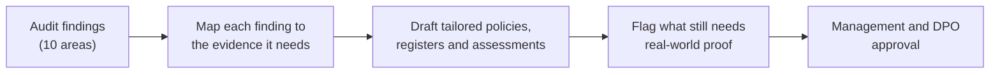

# FinTech SaaS: Data Protection Compliance Programme

Turning an audit verdict of *"substantially compliant, evidence required"* into a complete, audit-ready evidence pack. After an external data protection audit, I built a 30-document compliance programme for a fintech start-up, mapping every audit area to a policy, register or assessment, including a DPIA for its open-banking feature, a legitimate interest assessment and a full Record of Processing Activities.

> **Context:** Real-world work for a technology company, September 2026. **The organisation, its product, people, suppliers and registration details have been anonymised.** The company is referred to as "the Company" and its product as "the Platform". Documents are shown as v0.9 drafts prepared for management and DPO approval.

---

## At a glance

| | |
|---|---|
| **Framework** | Nigeria Data Protection Act (NDPA) 2023, a GDPR-modelled law (see the [UK GDPR mapping](#how-this-maps-to-uk-gdpr)) |
| **Organisation** | Fintech SaaS start-up: cloud invoicing, bookkeeping and open-banking bank sync for freelancers and small businesses |
| **Trigger** | External compliance audit: *"Substantially compliant: improvements and documentary evidence required"* |
| **Deliverable** | 30-document evidence pack covering all 25 audit evidence requirements plus 4 supplements |
| **Highlights** | DPIA for bank sync · LIA for security logging · 9-activity ROPA · breach, rights, retention, transfer and processor controls |

## Contents

- [The problem](#the-problem)
- [My approach](#my-approach)
- [The evidence pack](#the-evidence-pack)
- [Featured work](#featured-work)
- [How this maps to UK GDPR](#how-this-maps-to-uk-gdpr)
- [Skills demonstrated](#skills-demonstrated)

---

## The problem

An external data protection compliance auditor assessed the Company against the NDPA 2023 across ten areas: policies, data protection principles, lawful basis, security, DPIAs, ROPA and accountability, data subject rights, breach management, international transfers and processor management.

The verdict: **"Substantially compliant: improvements and documentary evidence required."** The Company had *reported* most controls in its compliance return but could not yet *demonstrate* them. Specific gaps included no legitimate interest assessments and lawful bases that had not been mapped to individual processing activities.

> The auditor's method, *Management response → Evidence required → Finding → Recommendation*, distinguishes a control that has merely been **reported** from one that can be **demonstrated, tested and evidenced.**

## My approach

1. **Map:** turned the audit's evidence requests into a master index of 25 requirements, each linked to a specific document.
2. **Tailor:** wrote every document for the Company's actual product (checked against its live website), not generic templates.
3. **Be honest about gaps:** every document is clearly marked as a draft until approved and implemented. Wherever a fact needs confirming (supplier locations, API scopes, retention periods), it is flagged `[confirm]` rather than assumed.
4. **List what can't be written:** a separate checklist names the real evidence still needed, such as signed approvals, training attendance, system screenshots for MFA and encryption, penetration test reports, signed processor agreements and restore-test results.

## The evidence pack

| Area | Documents |
|---|---|
| **Governance** | Data Protection Policy · Information Security Policy · Management Review and Corrective Actions · Semi-Annual Data Protection Report |
| **Accountability** | Record of Processing Activities · Lawful Basis Register · Consent Procedure and Register · Legitimate Interest Assessment · DPIA Register and DPIA |
| **Individuals' rights** | Data Subject Rights Procedure · DSAR and Complaint Register · Privacy Notice |
| **Security** | Access Control Policy and User Access Matrix · Encryption and Security Evidence · Penetration Test Tracker · Backup, BC and DR Plan |
| **Incidents** | Breach Response Procedure · Breach Register · Notification and Tabletop Exercise Templates |
| **Lifecycle** | Retention and Secure Disposal Policy · Deletion Evidence Log · Privacy by Design Procedure · Data Quality and Minimisation Procedure |
| **Third parties** | Processor Register · Data Processing Agreement Template · Processor Due Diligence Questionnaire · Sub-Processor Register · International Transfer Register and Transfer Risk Assessment |
| **People** | Staff Privacy Training Plan and Records |

Full audit-to-document mapping: [`data/evidence-map.csv`](data/evidence-map.csv)

## Featured work

### 📄 [DPIA: automatic bank sync and payment matching](docs/dpia-bank-sync.md)
A data protection impact assessment for the Platform's open-banking feature, the highest-risk processing it does. Six risks were assessed, from account takeover to data kept after a user disconnects their bank. **Key design control:** automated payment matches are never finalised without user confirmation, so a wrong match can't silently mark an invoice as paid.

### 📄 [Legitimate interest assessment: security logging](docs/lia-security-logging.md)
Closes a specific audit finding (no LIAs). A three-part purpose, necessity and balancing test for collecting IP, device and authentication logs, with safeguards against scope creep into employee monitoring or profiling.

### 📊 [Record of Processing Activities](data/ropa.csv)
Nine processing activities, from waitlist marketing to bank sync and security monitoring. Each has data subjects, data categories, purpose, lawful basis, recipients, retention and owner. It also identifies where the Company acts as a **processor** (for users' own client data) rather than a controller.

### Breach response procedure (summary)
A seven-step procedure: **detect and report → contain and preserve evidence → scope (systems, data, people, cause) → assess harm → decide and document notification → recover and validate → root-cause review.** Every incident is recorded, *including decisions not to notify*, and tested through periodic tabletop exercises.

## How this maps to UK GDPR

The NDPA 2023 is closely modelled on the GDPR, so this programme transfers directly to UK roles:

| This programme | UK GDPR / DPA 2018 equivalent |
|---|---|
| Record of Processing Activities | Article 30 |
| Lawful basis register | Article 6 |
| Legitimate interest assessment (three-part test) | Article 6(1)(f), following the ICO's LIA approach |
| DPIA for high-risk processing | Article 35 |
| Breach response and register | Articles 33–34 (report to the ICO within 72 hours; record all breaches) |
| Data subject rights procedure | Articles 12–22 (one-month response to subject access requests) |
| Processor register and data processing agreements | Article 28 |
| International transfer register and risk assessment | Chapter V (IDTA / UK Addendum and transfer risk assessments) |
| Privacy by design procedure | Article 25 |
| DPO reporting and management review | Articles 37–39 and the accountability principle (Article 5(2)) |

## Skills demonstrated

- **Data protection law:** NDPA 2023, with a working mapping to UK GDPR and DPA 2018
- **Privacy assessments:** DPIA, legitimate interest assessment, lawful basis mapping
- **Accountability records:** ROPA, processor and sub-processor registers, DSAR, breach and transfer registers
- **Audit remediation:** turning findings into an evidence map, closing gaps, preparing for re-assessment
- **Third-party and transfer risk:** processor due diligence, data processing agreements, transfer risk assessments
- **Privacy by design:** human-in-the-loop controls, minimisation, opt-in features
- **Professional integrity:** clearly separating drafted documents from implemented, evidenced controls
- **Product understanding:** applying privacy to a real fintech product, informed by my front-end development background

## Files in this folder

| File | What it is |
|---|---|
| [`docs/dpia-bank-sync.md`](docs/dpia-bank-sync.md) | DPIA for the open-banking bank sync feature |
| [`docs/lia-security-logging.md`](docs/lia-security-logging.md) | Legitimate interest assessment for security logging |
| [`data/ropa.csv`](data/ropa.csv) | Record of Processing Activities (9 activities) |
| [`data/evidence-map.csv`](data/evidence-map.csv) | Audit requirement → evidence document mapping |

---

← [Back to portfolio](../../README.md)
