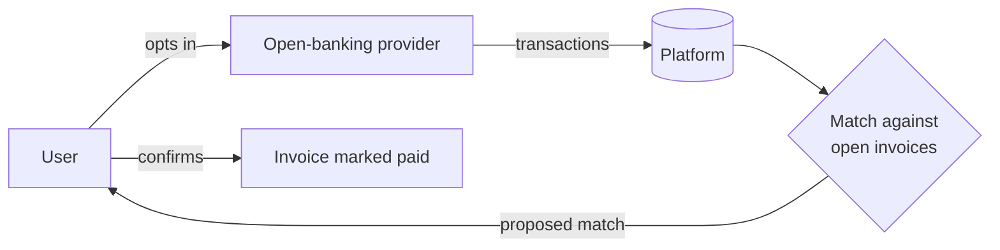

# DPIA: Automatic Bank Sync and Payment Matching

> Part of an anonymised [data protection compliance programme](../README.md). The organisation and product names have been removed; "the Platform" is a cloud invoicing and bookkeeping app for freelancers and small businesses.

| | |
|---|---|
| **DPIA reference** | DPIA-001 |
| **Trigger** | Financial transaction data; systematic automated analysis |
| **Owner** | Product Owner |
| **Status** | Draft v0.9: architecture to be validated with engineering before sign-off |
| **Review** | Before launch and before any material change |

---

## 1. Description of processing

A user chooses to connect a bank account. Transaction data is synchronised to the Platform, shown for real-time business tracking, and compared with open invoices using **amount, reference and timing**. A proposed match is **not marked as paid until the user confirms it.**

*To confirm with engineering and the open-banking provider's documentation: the actual API, token handling, storage and deletion design.*

## 2. Necessity and proportionality

- **Optional by design:** bank sync is opt-in, and manual workflows stay available where feasible.
- **Data minimisation:** collect only the fields needed for transaction display, reconciliation and approved tax reporting.
- **Purpose limitation:** no use for unrelated credit scoring, advertising or sale without a new legal assessment.
- **Transparency and control:** clear notice plus in-product controls to connect, access, correct and disconnect.

## 3. Risk assessment

| # | Risk | Potential harm to individuals | Existing control | Initial risk | Required mitigation | Residual risk |
|---|---|---|---|---|---|---|
| 1 | Unauthorised account connection or access | Account takeover exposes transactions | MFA / re-authentication *(to confirm)* | 🔴 High | Enforce strong authentication, scoped tokens, alerts and review | To assess |
| 2 | Excessive financial data | More history or fields collected than needed | API scope *(to confirm)* | 🔴 High | Document minimum fields and history; configurable retention | To assess |
| 3 | Incorrect automated match | Invoice wrongly treated as paid | User confirmation step | 🟠 Medium | No automatic finalisation; audit and correction trail | 🟡 Low–Medium |
| 4 | Processor or international transfer risk | Vendor or overseas processing compromises data | Contracts and security *(to obtain)* | 🔴 High | Due diligence, data processing agreement, confirmed locations, transfer risk assessment, sub-processor list | To assess |
| 5 | Retention after disconnection | Tokens or data persist unnecessarily | Deletion process *(to confirm)* | 🔴 High | Revoke token on disconnect; deletion workflow; backup expiry | To assess |
| 6 | Breach of transaction data | Financial harm and loss of confidentiality | Encryption and logging *(to evidence)* | 🔴 High | Penetration test, access review, encryption evidence, incident response test | To assess |

## 4. Design decision worth noting

Risk 3 shows privacy by design in practice. Automated matching could silently mark invoices as paid, so **a human (the user) always confirms the match.** That single design choice brings the risk down from Medium to Low–Medium, and it is also good UX.

## 5. Sign-off

Decision: ☐ Approve ☐ Approve with actions ☐ Do not approve

| Role | Signature | Date |
|---|---|---|
| Product Owner | | |
| Data Protection Officer | | |
| Risk Owner | | |

*Residual risks are deliberately left "to assess": they can only be rated once the controls marked "to confirm" are evidenced. Rating them now would overstate assurance.*

---

← [Back to case study](../README.md)
