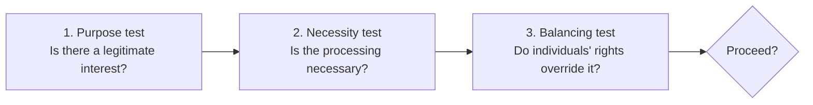

# Legitimate Interest Assessment: Security Logging and Monitoring

> Part of an anonymised [data protection compliance programme](../README.md). Organisation and product names have been removed.

| | |
|---|---|
| **Activity** | Security logging, monitoring, and prevention and investigation of misuse |
| **Purpose** | Protect the Company, the Platform, its users, data and service integrity |
| **Personal data** | IP address, device and browser, authentication, audit and event metadata *(to confirm)* |
| **Individuals** | Users, administrators, personnel and suspected threat actors |
| **Owner** | Technology / Security Lead |
| **Status** | Draft v0.9: DPO validation required |

---

A legitimate interest assessment (LIA) uses a three-part test. Processing can only rely on legitimate interest if it passes all three.

## 1. Purpose test

The Company has a legitimate interest in running a secure service: detecting unauthorised access, investigating anomalies, and protecting users and business assets.

**Limit:** the logs must **not** be repurposed for unrelated behavioural profiling without a separate assessment.

## 2. Necessity test

Proportionate logging is necessary, because access and incident investigations cannot reliably be carried out without event evidence.

**Condition:** the Company must document **why each log field and retention period is needed**, and switch off unnecessary payload or content logging.

## 3. Balancing test

| Factor | Assessment and action |
|---|---|
| **Reasonable expectations** | Users reasonably expect security logs. Explain any material monitoring in the privacy notice. |
| **Impact** | Risks include over-collection, employee monitoring, false suspicion and a breach of the logs themselves. |
| **Vulnerability** | Take extra care with any vulnerable users; avoid logging sensitive content. |
| **Safeguards** | Minimise fields, restrict access, encrypt, set expiry, audit privileged access, use logs only for security. |
| **Opt-out** | An opt-out could undermine security, so keep processing strictly necessary and provide a rights and complaints route instead. |

## Conclusion

**May proceed only after** the DPO confirms the data fields, retention period, access controls and privacy notice wording. Review annually or on material change.

---

← [Back to case study](../README.md)
